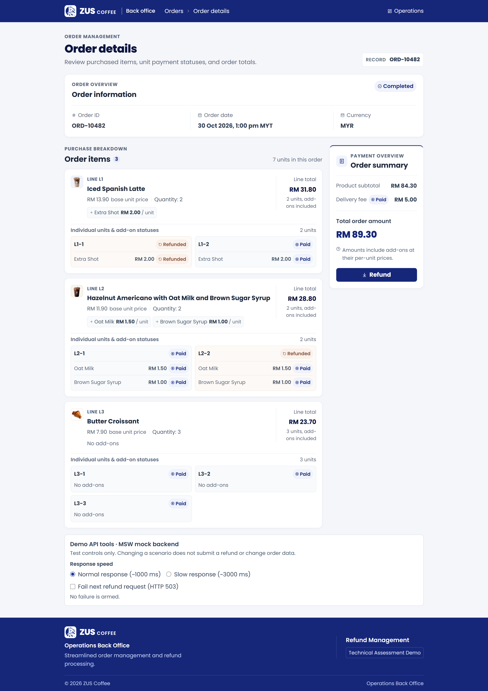
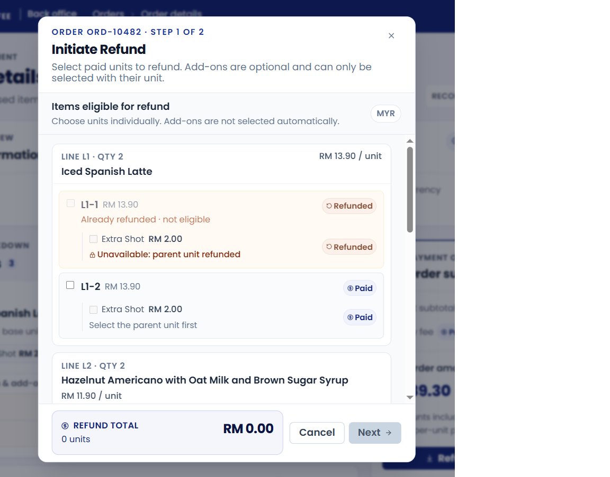
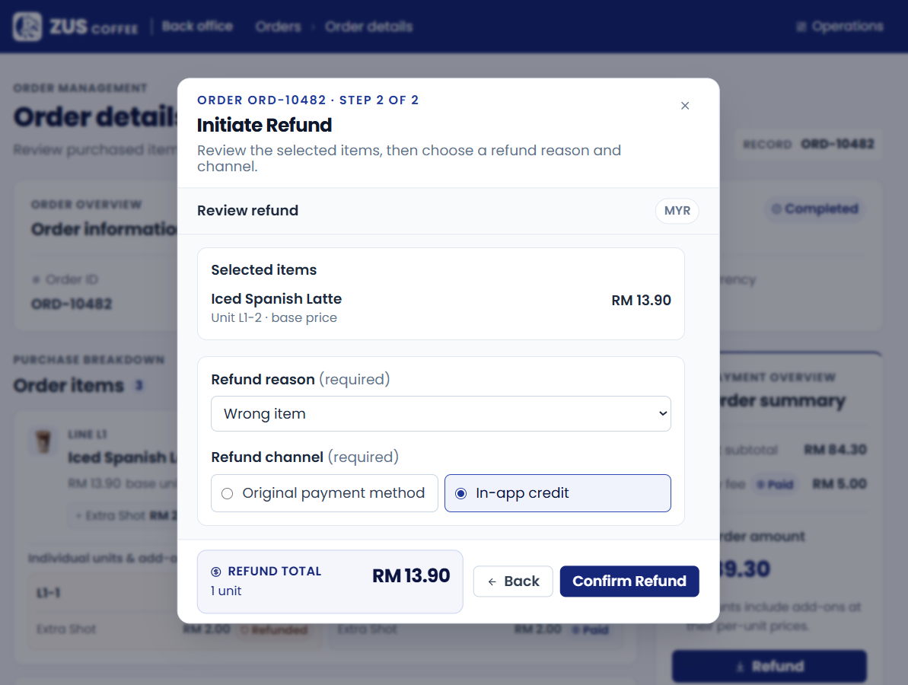
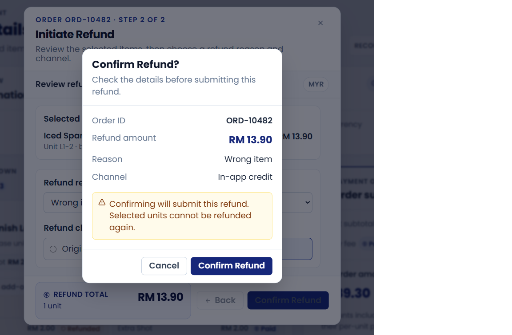

# ZUS - Regional Senior Frontend Developer:Technical Assessment(Refund Flow)

A React, TypeScript, and Vite assessment demo for reviewing orders and processing mock refunds. Native `fetch()` requests are intercepted by Mock Service Worker (MSW), so no backend server or payment service is required.

**Tech stack:** React, TypeScript, Vite, Tailwind CSS v4, Radix UI, Lucide React, native fetch, MSW, Vitest, and React Testing Library.

## Live Demo

[View Live Application](https://zus-refund-app-assessment.vercel.app)
[View Live Application (API Demo tools)](https://zus-refund-app-assessment.vercel.app/?demoTools=1)

## Contents

- [Run locally](#run-locally)
- [Technical Design & Considerations](#technical-design--considerations)
- [Application Screenshots](#application-screenshots)

## Run locally

### 1. Prerequisites and installation

- Install **Node.js 24.x** and npm. `package.json` pins this major version so Vercel builds use the same Node major as local verification.
- Clone or download this repository, then open a terminal in the project root (the folder containing `package.json`).

Install the dependencies using the committed lockfile:

```sh
npm ci
```

No environment file is required for the demo. MSW is enabled by default in both development and production preview. If you create `.env.local` from `.env.example`, keep `VITE_DEMO_MODE=true`. Setting it to `false` requires an available real backend configured through `VITE_API_BASE_URL`.

On Windows PowerShell, if `npm` is blocked because `npm.ps1` cannot run, use `npm.cmd` for these commands, for example `npm.cmd ci` and `npm.cmd run dev`.

### 2. Start the development server

```sh
npm run dev
```

Open the local URL printed in the terminal, normally [http://localhost:5173](http://localhost:5173). Vite may select another port if that port is occupied; use the printed URL. Source changes update automatically while the server is running.

Press **Ctrl+C** in the terminal to stop the server.

### 3. Enable and use demoTools

With `npm run dev` running, add `?demoTools=1` to the app URL:

[http://localhost:5173/?demoTools=1](http://localhost:5173/?demoTools=1)

Use the actual development port if it differs. Scroll below the order items to find the **Demo API tools · MSW mock backend** panel, outside the refund dialogs.

| Control | Behavior |
|---|---|
| Normal response (~1000 ms) | Simulates approximately one second of API latency. |
| Slow response (~3000 ms) | Simulates approximately three seconds of API latency to inspect loading and disabled controls. |
| Fail next refund request (HTTP 503) | Arms a deterministic failure for the next refund submission. Changing the control does not submit a refund or change order data. |

To test failure and retry:

1. Check **Fail next refund request (HTTP 503)** in the demo panel.
2. Click **Refund**, select an eligible unit and any desired add-ons or delivery fee, then click **Next**.
3. Choose a refund reason and channel. Click **Confirm Refund**, then submit from the final confirmation dialog.
4. The API returns HTTP **503**, displays an error, and preserves the refund draft and order statuses.
5. Retry from the confirmation dialog without arming another failure. A valid request succeeds with HTTP **201**, closes both dialogs, and refreshes the order through GET.

The failure setting is consumed once, and subsequent requests return to normal latency. To test a successful slow response, select **Slow response** and leave the failure checkbox unchecked. Open browser DevTools → **Network → Fetch/XHR** to inspect the GET order and POST refund requests and their JSON responses.

**Visibility rule:** the panel requires demo mode and `?demoTools=1`. It is hidden by default in development, production preview, and the deployed assessment demo. The parameter enables it in all three environments. Reloading the app resets the in-memory mock order and scenarios; to retry a failed refund while preserving its draft, use the dialog instead of reloading.

### 4. Build and run production preview

Build the app first, then serve the generated `dist` folder:

```sh
npm run build
npm run preview
```

Open the URL printed by the preview server, normally [http://localhost:4173](http://localhost:4173). MSW initializes before the app loads and intercepts API requests in preview too; refunds work without a backend. The worker script is included in the build.

Preview serves the last production build and does not update source changes automatically. After changing source files, run `npm run build` again and reload the browser. Press **Ctrl+C** to stop preview. Running preview does not deploy the application.

## Technical Design & Considerations

### a) API Endpoints

The refund workflow requires two API endpoints. The demo uses Mock Service Worker (MSW) to intercept HTTP requests, simulate backend behavior, and return realistic responses without requiring a backend server.

**1. GET `/api/orders/:orderId`**

Retrieves order details, including purchased items, individual units, add-ons, payment statuses, and delivery fee.

**Request:**
- Method: `GET`
- Path parameter: `orderId`

**Response (200 OK):**
```json
{
  "order_id": "ORD-10482",
  "order_date": "2026-10-30T05:00:00.000Z", // New data field added to give more details on the order and necessary in the real world example
  "status": "completed",
  "currency": "MYR",
  "delivery_fee": 5.00,
  "delivery_fee_status": "paid",
  "items": [
    {
      "line_id": "L1",
      "base_product_id": "SL1", // New data field added to give a unique id key for a particular product
      "name": "Iced Spanish Latte",
      "unit_price": 13.90,
      "quantity": 2,
      "units": [
        {
          "unit_id": "L1-2",
          "status": "paid",
          "addons": [
            {
              "addon_id": "A1",
              "name": "Extra Shot",
              "price": 2.00,
              "status": "paid"
            }
          ]
        }
      ]
    }
  ]
}
```

*Response shortened for readability.*

**2. POST `/api/orders/:orderId/refunds`**

Submits a refund for selected units, add-ons, and optionally the delivery fee.

**Request:**
- Method: `POST`
- Content-Type: `application/json`

**Example request body:**
```json
{
    "requestId": "1bf271e8-9776-44ae-88ad-acfdd537b425",
    "orderId": "ORD-10482",
    "selection": {
        "selectedUnitIds": [
            "L1-2"
        ],
        "selectedAddOns": [
            {
                "unitId": "L1-2",
                "addonId": "A1"
            }
        ],
        "includeDeliveryFee": false
    },
    "reason": "Wrong item",
    "channel": "in-app-credit"
}
```

**Example response (201 Created):**
```json
{
  "success": true,
  "orderId": "ORD-10482",
  "refundAmount": 15.90,
  "currency": "MYR",
  "status": "success"
}
```

**Error responses:**

Failures use a consistent JSON envelope with `success: false`, `status: "error"`, and an error code, message, and details array. Order endpoints include the path's `orderId`; an unknown endpoint without an order context omits it. For example, a simulated HTTP 503 response is:

```json
{
  "success": false,
  "orderId": "ORD-10482",
  "status": "error",
  "error": {
    "code": "SIMULATED_FAILURE",
    "message": "The refund service is temporarily unavailable. Please try again.",
    "details": []
  }
}
```

| Status | Description |
|---|---|
| 400 | Malformed request |
| 404 | Order not found |
| 409 | Another refund is in progress, or a request ID was reused with different input |
| 422 | Invalid refund selection or previously refunded unit |
| 500 | Unexpected mock service error |
| 503 | Simulated service unavailable |

The POST success body contains exactly the five fields above. `refundAmount` is a decimal MYR amount calculated from integer sen on the mock server; JSON may serialize `15.90` as `15.9`. Internal receipts, request IDs, and order snapshots are not returned in this body. The response carries `X-Order-Version` separately as an exposed HTTP header. The fetch client validates the body and version header, then returns an internal `{ refund, version }` result to the UI. After success, the UI fetches GET order data and rejects snapshots older than the returned version. GET retains its existing `{ order, version }` response contract.

The mock API supports configurable response delays and deterministic failure simulation for testing loading, error handling, and retry behavior. Validation errors use HTTP 422 with details explaining the invalid selection. Failures preserve the draft and never show success. An identical request ID and payload safely replay the original refund result without another commit; a later request for an already-refunded unit is rejected. Internal receipts and the authoritative order store continue using integer minor units.

### b) Refund Calculation

The refund amount is calculated on both the frontend and backend, with different responsibilities.

**Frontend:**
- Calculates the estimated refund amount in real time as staff select units, add-ons, or the delivery fee.
- Uses a reusable, pure TypeScript calculation utility.
- Uses integer minor units (sen) to avoid floating-point precision issues.
- Displays the same calculated amount across selection, review, and confirmation steps.

**Backend (simulated using MSW):**
- Validates the refund request against the current order state.
- Checks that selected units and add-ons are eligible for refund.
- Independently recalculates the authoritative refund amount.
- Rejects invalid selections and prevents duplicate refunds.
- Updates the order state only after successful validation.

In a production system, the backend must be the source of truth. The frontend calculation is only a preview, and the backend-calculated amount is the amount actually processed.

To maintain consistency, the frontend and mock backend reuse the same calculation rules. In a real backend integration, the server would independently enforce those rules, and the UI would display the confirmed refund amount returned by the API.

### c) Assumptions, Questions & Comments for the PM or Designer

**Assumptions:**

- Refunds are performed at the individual unit level, even when an item was purchased in multiple quantities.
- Already-refunded units cannot be refunded again.
- Add-ons can only be refunded together with an eligible parent unit.
- Selecting a unit does not automatically select its add-ons.
- The delivery fee can be refunded independently when its status is paid.
- A full refund means selecting all remaining eligible units, their eligible add-ons, and the delivery fee.
- Authentication, user roles, and payment gateway integration are outside the assessment scope.

**Data inconsistencies:**

- The supplied order data contains a refunded unit (`L2-2`) with add-ons still marked as paid. The implementation treats these add-ons as ineligible because their parent unit has already been refunded.
- The supplied data supports a maximum remaining refundable amount of **RM59.00**, including the delivery fee. This differs from the **RM77.30** shown in the assessment screenshot. The implementation follows the supplied data and refund eligibility rules.

**Questions for the PM or designer:**

- Should selecting a parent item automatically select its add-ons?
- Should a delivery fee refund be allowed without refunding any items?
- Should a reason or additional explanation be required when selecting "Other"?
- Should there be a maximum refund amount or special approval for certain refunds?
- How should partially refunded orders and remaining paid add-ons be represented in the UI?
- Should staff be able to view historical refund transactions?

### d) Key Decisions & Trade-offs

**React + TypeScript + Vite**

Chosen for fast development, type safety, reusable components, and a lightweight project setup.

**Feature-based component organization**

The refund workflow is separated into components, hooks, types, and utilities to improve maintainability and testability.

**Local React state management**

React state is sufficient for the relatively small refund workflow. Redux or Zustand would introduce additional complexity without significant benefit for this assessment.

**Reusable refund calculation utility**

Business calculations are separated from UI components, making them reusable and independently testable.

**MSW + native fetch()**

MSW provides realistic HTTP request handling, status codes, latency simulation, and failure scenarios without requiring a real backend.

This adds some configuration compared with direct in-memory mock functions, but makes the application closer to a real API integration and allows requests to be inspected in browser developer tools.

**Unit-level refund selection**

Individual units have separate selection states to support partial refunds accurately. Add-on instances are identified using their parent unit to avoid collisions when add-on IDs are reused.

**Radix UI and Tailwind CSS**

Radix UI provides accessible interaction primitives, while Tailwind CSS enables consistent, responsive styling without building a large custom component library.

### e) Known Limitations & Next Steps

**Current limitations:**

- No real backend, database, or payment gateway integration.
- Mock order updates are stored in memory and reset when the application is reloaded.
- No authentication, authorization, or role-based refund permissions.
- No persistent refund history or audit trail.
- No integration with real payment providers.
- The demo handles a predefined sample order rather than a full order management system.

**Next steps with more time:**

1. Integrate real backend APIs and persist refunds in a database.
2. Add backend authorization and audit logging for refund operations.
3. Introduce idempotency keys to safely handle repeated payment requests.
4. Support refund transaction history and detailed refund statuses.
5. Add automated end-to-end tests using Playwright.
6. Improve observability, API monitoring, and error reporting.
7. Expand coverage for additional refund scenarios and edge cases.

## Application Screenshots

The following screens show the order details and the three stages of the refund workflow.

### Order Details Page

Order information, product images, individual unit and add-on payment statuses, and the historical order total.



### Refund Selection Modal

Unit-level selection with disabled refunded units, add-on eligibility guidance, and a running refund total.



### Refund Review Step

A review of the selected unit and its price, with the required refund reason and refund channel.



### Refund Confirmation Dialog

The final confirmation shows the order ID, refund amount, reason, channel, and submission warning.


